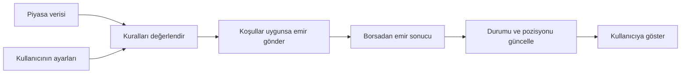

# Ne yapıyoruz ve neyi amaçlıyoruz?

MeeApps'in bu projedeki işi, Borsa İstanbul'daki piyasa verisini takip eden, kullanıcı tarafından belirlenen kurallarla alım-satım emirleri üreten ve bu emirlerin sonuçlarını kullanıcıya gösteren bir işlem sistemi geliştirmektir. Kullanıcının gördüğü mTrader arayüzü, bu sistemi yönetmenin ve izlemenin yoludur.

Buradaki **emir**, belirli bir üründen belirli miktarda almak veya satmak için verilen talimattır. **Strateji** ise hangi koşulda, hangi fiyat ve miktarla emir verileceğini belirleyen kurallar bütünüdür. Kullanıcı bu kuralların ayarlarını seçer; çalışan yazılım, piyasa olaylarını bu ayarlara göre değerlendirir.

## Hangi ihtiyacı karşılıyoruz?

Piyasada fiyatlar ve alım-satım için bekleyen miktarlar sürekli değişir. Bir insan ekrandan bunları izleyip emir girebilir; ancak her değişikliği aynı hız ve tutarlılıkla değerlendirmesi zordur. Özellikle kısa süreli fırsatlarda veriyi görmek, karar vermek ve emri iletmek arasındaki süre önem kazanır.

Bizim sistemimiz bu sürecin kurallarla tanımlanabilen kısmını otomatikleştirir. Örneğin bir fiyat seviyesindeki satış miktarının azalmasını izleyebilir, iki ilişkili ürünün fiyatlarını karşılaştırabilir veya önceden hazırlanmış emirleri belirlenen zamanda gönderebilir. Bunlar farklı strateji ve emir akışlarıdır; hepsi aynı koşulla çalışmaz.

Amaç, seçilen işlem yaklaşımını hızlı, tekrarlanabilir ve izlenebilir biçimde uygulamaktır. Bir koşulun oluşması emrin kesin gerçekleşeceği, gerçekleşmesi de işlemin kârla sonuçlanacağı anlamına gelmez. Karşı taraftaki miktar ve fiyat, emir piyasaya ulaşana kadar değişebilir.

## Kullanıcı neyi yönetir?

Kullanıcı, yetkisi olan hesap ve ürünler üzerinde hangi stratejiyi çalıştıracağını seçer. **Hesap**, işlemin kimin adına yapıldığını; **ürün** ise hangi pay, vadeli sözleşme veya başka finansal araç üzerinde işlem yapılacağını belirtir.

Stratejiye göre değişmekle birlikte kullanıcı; işlem miktarı, tetikleyici eşik, fiyat koşulları ve çıkış ayarları gibi parametreleri düzenler. Stratejiyi başlatır veya durdurur; emirleri, gerçekleşmeleri ve pozisyonunu izler. **Pozisyon**, yapılan işlemler sonucunda ilgili üründe elde tutulan net miktardır.

Arayüzdeki bir ayar, arka tarafta uygulanacak bir kurala karşılık gelir. Bu yüzden bir alanın yalnız ekranda nasıl göründüğünü değil, motora hangi değerle gönderildiğini ve hangi davranışı değiştirdiğini de bilmek gerekir. İleride stratejileri bu bağlantıyla anlatacağız.

## Basit bir örnek

Bir ürünün 10,00 TL fiyatında satış için bekleyen 1.000 lot olduğunu düşünelim. Bu örnekte lotu işlem miktarının birimi olarak kullanıyoruz; ürünlerin miktar özelliklerini borsa temellerinde ayrıca ele alacağız.

Kullanıcı, satış miktarı belirli bir eşiğin altına indiğinde alış koşulunu değerlendiren bir strateji çalıştırmış olsun. Sistemin kavramsal akışı şöyledir:

1. Piyasadan yeni veri gelir: o fiyatta bekleyen satış miktarı azalmıştır.
2. Çalışan strateji yeni durumu kullanıcının ayarlarıyla karşılaştırır.
3. İlgili koşullar uygunsa bir alış emri oluşturulup borsaya iletilir.
4. Emir kabul edilebilir, reddedilebilir veya kısmen/tamamen gerçekleşebilir.
5. Gelen sonuçlar işlenir; kullanıcı emir durumunu ve varsa oluşan pozisyonu izler.

Bu, belirli bir stratejinin bütün giriş şartlarını tanımlayan test senaryosu değildir. “Veri geldi, kurala bakıldı, emir üretildi, sonucu işlendi” ilişkisini gösteren eğitim örneğidir. Gerçek tetik, miktar ve fiyat hesaplarını strateji bölümünde inceleyeceğiz.

Şema işlevsel akışı gösterir. Kutular ayrı container veya program anlamına gelmez; gerçek bileşen ve bağlantı haritası mimari bölümünde ele alınacak.

## Bizim sistemdeki karşılığı

Bu işi birden fazla uygulama ve kütüphane birlikte yapar. Şimdilik isimleri görevleriyle eşleştirmek yeterlidir:

| Parça | Bu anlatımdaki görevi |
|---|---|
| **mTrader arayüzü** (`mtrader-trade-ui`) | Kullanıcının ayarları girdiği ve sonuçları izlediği ekranlar |
| **Merkez servis** (`trade-data-app`) | Arayüz ile diğer uygulamalar arasında veri ve komut iletişimi; veritabanı işlemleri |
| **Strateji motorları** (`HftSrvProd`, `AlgorithmicTrading` / AlgoProd) | Strateji kurallarını değerlendiren ve emir kararını üreten uygulamalar |
| **Emir iletim katmanı** (`order-service` ve emir SDK'ları) | İlgili akışa göre emirlerin borsaya iletilmesi ve yanıtlarının işlenmesi |
| **Piyasa verisi katmanı** (`itch-sdk`) | Borsanın veri akışından uygulamaların kullanacağı piyasa bilgisinin oluşturulması |

**SDK**, başka bir uygulamanın kullandığı hazır yazılım kütüphanesidir. Bu tabloda uygulamalarla kütüphaneler birlikte görev özeti olarak gösteriliyor; hepsi ayrı çalışan servis değildir. Bir emrin hangi parçalar üzerinden geçtiği stratejiye ve çalışma aşamasına bağlıdır. Burada bütün emirlerin aynı yolu izlediğini varsaymıyoruz.

## Bu rehberi okuyunca neyi yapabilmeliyiz?

Bir ekran alanının hangi işlem kuralını değiştirdiğini açıklayabilmek, verilen ayar ve piyasa koşulunda beklenen sonucu tarif etmek ve bunu bir test senaryosuna dönüştürebilmek hedefleniyor. Böylece “ekranda bir şey olmadı” gibi bir bildirim geldiğinde hangi komutun, piyasa olayının veya emir sonucunun inceleneceğini seçebiliriz.

Bunun için önce borsa dilini, sonra teknik kavramları öğreneceğiz. Ardından gerçek sistem bağlantılarını ve her stratejinin GUI ile motor tarafındaki çalışma prensiplerini birleştireceğiz. Bu girişte parametre listeleri ve kod ayrıntıları yerine sistemin ne için var olduğunu netleştiriyoruz.

## Sorularımız ve netleşen noktalar

**24 Ekim 2026 — Kullanıcının başlangıç beklentisi, anlamı korunmuş özet:** Önce uygulamanın ne yaptığını ve neyi amaçladığını kısa bir açıklamayla anlatalım; ardından borsa ve teknik temellere geçelim.

**Metne yansıması:** Uygulamanın amacı, kullanıcı kontrolü, veri–karar–emir–sonuç ilişkisi ve küçük bir örnek eklendi. Kullanıcı ayrıca yazım sürerken kodları inceleyeceğini belirtti. Bu metne ilişkin yeni bir soru veya okuma geri bildirimi henüz gelmedi. Genel tercihler [karar kaydında](../kararlar.md).

## Kaynaklar ve doğrulama

Bu giriş, mevcut bilgi tabanındaki [sistem haritası](../../00-genel/sistem-haritasi.md), [strateji kataloğu](../../20-stratejiler/README.md), [arayüz özeti](../../10-servisler/mtrader-trade-ui/README.md) ve [strateji başlatma akışından](../../30-akislar/strateji-baslatma.md) derlendi. Frontmatter'daki commit'ler bu kaynak belgelerin referanslarıdır; bu tur kaynak kod yeniden incelenmedi. İçerik kullanıcı incelemesini bekleyen taslaktır.

Bu bölüm güncel seans saati, takas süresi veya belirli bir stratejinin emir/risk garantisi hakkında hüküm içermez. İnternet araştırması, uygulama testi ve canlı ortam doğrulaması yapılmadı.

## Devam notu

İlk anlatım taslağı yazıldı; henüz kullanıcı tarafından okundu/onaylandı sayılmıyor. [Kullanıcılar ve örnek iş günü](02-kullanicilar-ve-is-gunu.md) de yazıldı; ilk bölümün iki taslağı okuma ve revizyon bekliyor. Kullanıcı bu metinle ilgili soru getirirse önce ilgili açıklama ve bu dosyadaki soru kaydı güncellenecek.

[Bölüm indeksi](README.md) · [Ana indeks](../README.md)
